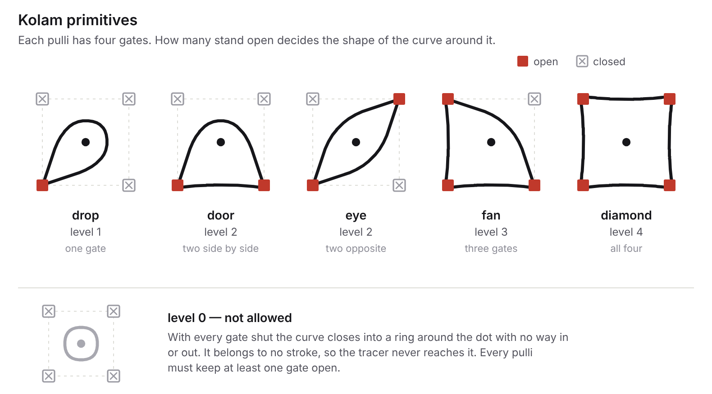
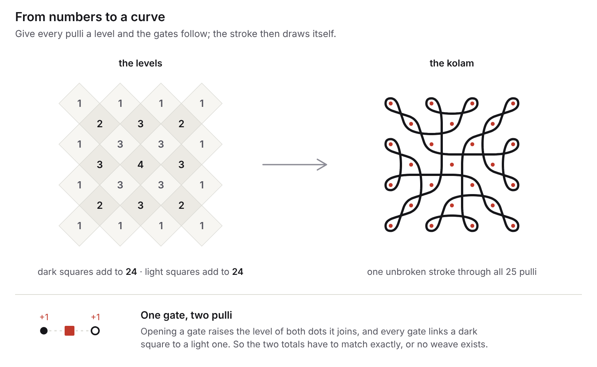

# Fourier-kolam

Kolam (rangoli) is a traditional South Indian form of line art, preserved by many generations of women. The artwork starts with a grid of dots called **pulli**, which forms the skeleton. A single line weaves around the dots without ever retracing itself, and the goal is to finish with every dot enclosed by the line. A fun challenge is to draw a kolam without lifting the hand in between. Such kolams are called **sikku kolam**, and they have attracted the attention of many mathematicians and computer scientists trying to solve the challenge of one-stroke generation [1,2]. For a given pulli pattern, only a small fraction of all possible kolams are sikku kolam, and that fraction falls fast as the grid grows.

The loop can be imagined as guided through 4 gates around each dot, as shown below. A gate is either open or closed. The loop passes straight through an open gate and gets diverted by a closed one. The number of open gates around a dot therefore decides the shape of the curve there, and I call that number its **level**. In the algorithm described in [3] the gating matrix is iteratively tuned so as to obtain a kolam in one stroke.

<picture>
  <source media="(prefers-color-scheme: dark)" srcset="docs/kolam-primitives-dark.png">
  
</picture>

One thing to note: a gate sits *between* two dots, so it belongs to both of them. Opening a gate raises the level of both dots it joins. This means the levels cannot be chosen freely. Colour the pulli like a chessboard, and every gate joins a dark square to a light one — so the total of the levels on the dark squares has to equal the total on the light squares, or no weave exists at all.

<picture>
  <source media="(prefers-color-scheme: dark)" srcset="docs/kolam-from-numbers-dark.png">
  
</picture>

In this code, I try to encode the Fourier amplitudes of an image as a kolam pattern. This is done by considering the pulli grid as Fourier frequencies and the number of open gates around each dot as its amplitude. The amplitudes are quantised to levels 1 to 4 before being assigned to a dot. Level 0 is not allowed: a dot with all four gates closed is sealed inside a ring of its own, belonging to no stroke at all. Because of the chessboard rule above, the quantised amplitudes usually cannot be drawn exactly as they come out of the transform, so they are nudged by the smallest amount that makes a weave possible. Pushing the result all the way to a single stroke costs a little more accuracy again — that is a choice left to you.

*Approximately representing the Fourier transform of an image as a kolam.*

## Try it on your own image

Open `kolam_studio.ipynb` in Colab, upload any image, and adjust the dot spacing, the mask and the palette to taste. Direct link: [kolam_studio.ipynb](https://github.com/AlokBharadwaj94/fourier-kolam/blob/main/kolam_studio.ipynb)

## References

1. Waring, T. M. (2012). Sequential encoding of Tamil kolam patterns. *Forma*, 27(1), 83–92.
2. Yanagisawa, K. & Nagata, S. Fundamental study on design system of kolam pattern. *Forma* 22, 31–46 (2007).
3. Sivakumar, S., Sivakumar, S. An algorithm for one-stroke kolam generation using a gating structure. *npj Herit. Sci.* 14, 144 (2026). https://doi.org/10.1038/s40494-026-02310-3

---

Built with Claude Opus 5.
